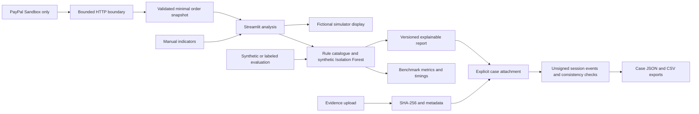

# Competition development architecture

The stable remote main remains at Phase 1 merge `4ec81c7`. This code is a local,
unpublished competition track. There is no deployment, Devpost or credential change.

The simulator remains an independent fictional display; it does not automatically
become an API-verified analysis source. Benchmark evaluation uses a separate path to
consume the same scorer/model, and does not write investigation cases.

## Components and boundaries

| Component | Responsibility |
| --- | --- |
| `app.py` | Existing connection/order/analysis/history/simulator UI and structured report display |
| `paypal_sandbox.py` | Hard-coded Sandbox host, OAuth via existing secrets, blocked redirects, TLS/timeouts, 1 MiB response cap, safe errors and minimal validated return fields |
| `transactions.py` | Finite nonnegative money, currency codes, immutable single-unit order snapshots, stale-source detachment, UUID analysis observation IDs |
| `scoring.py` | Single rule catalogue, strict boolean indicators, unchanged score weights/decision precedence, synthetic model fitting and output validation |
| `investigations.py` | Case/report/evidence operations, attribution, explicit evidence associations, snapshots and exports |
| `audit.py` | Canonical JSON digests, event sequencing and verification of event links/current state |
| `investigation_ui.py` | Separate session workspace below existing application controls |
| `benchmarking.py` | Strict labeled CSV parsing, independent synthetic labels, batched model evaluation and confusion metrics |
| `competition_benchmark.py` | Seed/size/repetition sweep; separate model-fit and warm-evaluation timings |

## Data lifecycle

All case state is per Streamlit session. Explicit attachments deep-copy reports;
case changes do not rewrite past analyses. At attachment time, a report snapshots
current evidence IDs/digests as **case associations**, not support verified for each
risk flag. Rule flags remain manually supplied and unverified even when an amount
came from Sandbox.

Each analysis UUID identifies an observation in this application, not a completed
payment or canonical PayPal transaction. Order IDs/statuses remain separate. Editing
a lookup ID, amount or currency detaches a prior order, including after lookup errors.
Non-USD values are shown in their original currency and cannot enter USD scoring.

The case audit events record creation/edits, evidence registration, report attachment,
and verification outcomes, with unverified actor references and UTC times. SHA-256
covers sorted compact UTF-8 JSON. The verifier checks linked events plus metadata,
evidence and report projections. It cannot authenticate an author, prove trusted time,
stop complete rewriting/recomputation or guarantee completeness after all state is lost.
Original file bytes are not stored in cases. The application never copies configured
credentials or raw customer API payloads into case exports. User-entered text is not
automatically redacted, so use only fictional or authorized metadata.

## Compatibility and deferred persistence

Rule weights stay 25/30/20/25; the large-amount condition stays strictly above USD
1,000. Decision precedence stays high score (>=60), then anomaly, then medium score
(>=30), then low indicated risk. Model training data/seed/parameters are unchanged.
New validation rejects string/numeric substitutes for booleans and invalid model
outputs. Existing scorer function signatures remain available. Report schema is 1.1;
prior exported cases are not imported or migrated because there is no restore feature.

Shared SQLite storage is intentionally deferred. No authenticated tenancy, retention
policy, backup process or durable hosting volume is established. A database alone
would not provide a safe investigation audit trail. Proposed storage work requires
those decisions before any deployment or credential configuration change.
